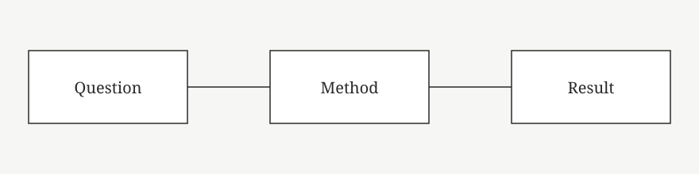

Sample: these notes show how a public write-up is structured. Replace the sections with your own internship record.

## Setup

The placeholder pipeline has three stages. The figure is a layout check, not a measurement.



## What I checked

| Check | Owner | Public result |
| --- | --- | --- |
| Task definition | Sample author | Not included |
| Collection pass | Sample author | Not included |
| Output review | Sample author | Not included |
| Long token | Sample author | SAMPLE_TOKEN_THAT_SHOULD_SCROLL_INSIDE_THE_TABLE_ON_A_NARROW_SCREEN |

## Field notes

> Sample quotation: record a constraint or a decision here, and keep invented metrics out of the note.

### Open question

Sample: a subsection used to check the nested contents entry.

## Code sketch

```ts
export function describeSample(stage: string) {
  const note = `TODO: replace this sample with what the ${stage} stage actually checked, and keep this line long enough that the code block scrolls sideways on a phone without widening the page.`;
  return note;
}
```

The fenced block uses a monospaced face and stays inside the page.

## Limits

Sample: say what this note does not establish.
