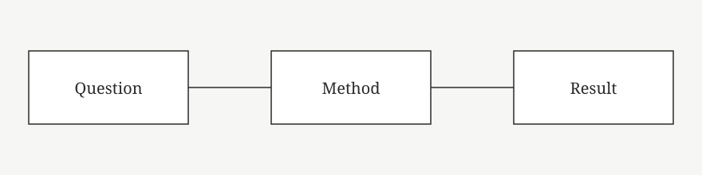

## Method

Sample: describe the method in prose. The figure below is a layout check. It does not show experimental data.

## Limits

Sample: say what the work does not show, which data you cannot share, and what a reader should not infer.
